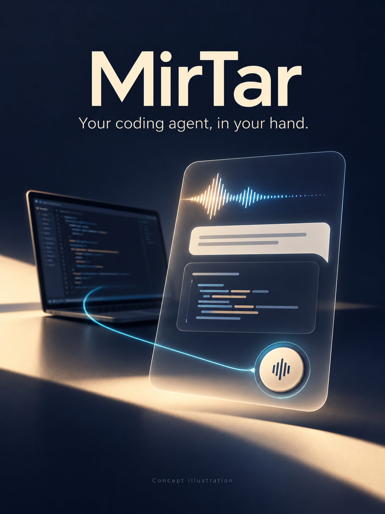

# MirTar

**把电脑上的编程 Agent，带到手里。**

[English](README.md) · [版本下载](https://github.com/Charlesmpc/MirTar/releases) · [使用说明](docs/server-onboarding.zh_CN.md)

<p align="center"><a href="https://github.com/Charlesmpc/MirTar/releases/download/v0.5.2/MirTar-bluetooth-demo-v0.5.2.mp4"></a></p>

<p align="center"><a href="https://github.com/Charlesmpc/MirTar/releases/download/v0.5.2/MirTar-bluetooth-demo-v0.5.2.mp4">观看蓝牙 Demo（26 秒）</a> · <a href="https://github.com/Charlesmpc/MirTar/releases/download/v0.5.2/MirTar-bluetooth-demo-v0.5.2-no-music.mp4">无配乐版</a> · <a href="docs/demos/bluetooth-v0.5.2.md">演示说明</a></p>

*真实卡片录像。动图为 4 倍速预览；完整视频分别标注缩短的配对与处理等待。*

<details>
<summary>概念示意图</summary>

<p align="center"></p>

*概念示意图，并非卡片实拍或界面截图。*

</details>

MirTar 把 FoloToy AI Passport 卡片变成**电脑上编程 Agent 的随身控制器和回复屏幕**。
不用戴耳机或一直凑到电脑麦克风前：按 OK 说话，再按 OK 发送，在卡片上阅读回复；
回到电脑后仍能继续操作**同一个 Agent 会话**。

做它的起因很简单：作者此前尝试通过手机上的 ChatGPT 远程连接电脑，但在自己的使用中经常断开。
于是把卡片到电脑的连接放到**局域网 Wi-Fi 或蓝牙**，配上实体按键和可以直接看回复的屏幕。

| 方式 | 能提供什么 | 为什么还需要 MirTar？ |
| --- | --- | --- |
| 蓝牙耳机 | 方便的麦克风和音频 | 缺少 Agent 会话选择控制器和文字回显；MirTar 提供专用按键与回复屏幕。 |
| 手机 App／云端远程连接 | 熟悉的屏幕和语音入口 | 经云端中转的控制依赖公网，作者此前使用时经常断开；MirTar 经 LAN 或蓝牙直接连到电脑。 |
| MirTar 卡片 | 语音输入、会话控制和回复显示 | 约 [50g](https://ai-passport.folotoy.cn/)，拿着比手机轻；操作 Agent 时，手机仍可以做别的事情。 |

**把控制链路留在本地。** 卡片与电脑之间无需云端中转，无需给桥接开放公网入口或配置端口映射。
蓝牙配对或接入可信局域网后，就可以按键说话。Agent 自身访问 Codex 服务仍需正常联网，
这不等于离线运行 Agent。BLE 使用认证加密和应用绑定；Wi-Fi 当前仍为明文，只适合可信局域网。

**OS 适配层独立于 Agent 和设备协议**：目前实现 Windows 桥接，后续计划实现 macOS、Linux。
当前 Agent 适配器是 Codex。**当前版本为 [v0.5.4](https://github.com/Charlesmpc/MirTar/releases/tag/v0.5.4)**：增加后台桥接、专用 Agent 会话和实验性卡片问答，同时保留边录边传与单次 10 分钟录音。
再次按 OK 后，等最后一段转写确认完成，再一次性提交到原桌面会话。实时转发需要更新桥接；解除旧的 30 秒上限还需要更新固件。
见 [v0.5.2 验证与升级说明](docs/validation/streaming-voice-0.5.2.md)。
v0.5.4 新增[卡片提问与语音答复](docs/agent-questions.zh_CN.md)，用于新建的桥接驱动会话；包含
[Delete server](docs/validation/delete-server-0.5.3.md)。真实 Codex、原生 ASR 与完成后会话接续已验证；作者已确认旧桌面转发模式下的实机蓝牙语音／回复闭环，卡片问答与删除操作仍待实机验收。

0.5.4 桥接还支持[首次启动自动创建工作区与自定义目录](docs/agent-questions.zh_CN.md#工作目录与首次启动)：
没有会话时，在用户目录创建 `MirTar/workspaces/default`，初始化专用会话并保存；重启继续使用该会话和目录。
已有配置保持原样，目录失败会提示在电脑端修复。
开机三个入口：Server list、Add server、Add config-file。蓝牙添加交换主机名称和绑定信息；
文件导入只在主动开启卡片热点后进行。每台主机保存自己的可选 Wi-Fi，默认连接方式仍是蓝牙。
作者已于 2026-10-25 确认 v0.5.1 实机验证通过；证据来源和剩余覆盖范围见[验证记录](docs/validation/server-onboarding-0.5.1.md)。

## 流程与操作

卡片 → Bluetooth（默认）或局域网 Wi-Fi → 桥接（设备传输／OS 适配／Agent 适配）→ 已有会话 → 回复回到卡片。
目前接入 Windows 和 Codex；macOS、Linux 将通过各自的 OS 适配实现接入。
桥接不另接 ASR 服务，也不要求额外 ASR API Key。会话、上下文和执行由 Codex 管理。
蓝牙模式不需要卡片和笔记本共享 Wi-Fi；电脑访问 Codex 本身仍可能需要互联网及原生语音额度。

1. Server list 查看已保存主机；Add server 只通过蓝牙添加。
2. Add config-file 开启卡片热点，扫码或手动连接后访问 `http://192.168.4.1`，上传准备好的 v2 设备 JSON。
3. 选择已保存主机，默认 Bluetooth；Wi-Fi 仅使用该主机自己的网络和电脑地址。
4. OK 开始录音，再次 OK 提交；上下翻阅，长按上下切会话，长按 OK 回首页。

**v0.5.1 蓝牙恢复：** 一分钟无法绑定时，连接页提供按键确认的配对重置。
蓝牙档案自动按 `server.id` 独立保存；只重置当前主机，保留其他主机、Wi-Fi 与应用绑定。
重置后按 OK 连接并输入新的 Windows 配对码，无需手工编辑蓝牙数据。
见[蓝牙恢复说明](docs/server-onboarding.zh_CN.md#蓝牙断线超过一分钟重置当前主机配对)。

## 开始使用

需要 AI Passport、BLE Windows、Node.js **24.13.0+**、Edge，以及已安装并登录的 Codex 桌面应用。
配置工具支持 Windows PowerShell 5.1／PowerShell 7；编译使用**ESP-IDF 5.5.6 / LVGL 9.5.0**。

```powershell
npm.cmd ci --ignore-scripts
# 只在尚无私有配置时运行，原有文件不覆盖：
.\tools\New-LocalConfig.ps1 -BluetoothOnly -BridgeOwned
# 卡片选 Add server，再在目标电脑运行：
.\tools\Add-Server.ps1
# 完成 Windows 配对码输入、卡片 OK 确认，再启动／重启普通桥接：
.\tools\Manage-BridgeService.ps1 -Action Install
```

主机显示名称默认电脑名，可在添加时编辑或用 `-Name` 指定；固定主机 ID 与显示名分离。
卡片不搜索或列出附近电脑，Windows 内部发现处于蓝牙添加窗口的卡片。
另一入口 Add config-file 支持上传文件，按 ID 新增／更新，保留其他主机。
旧 v1 配置先运行 `Convert-DeviceConfig.ps1`，得到独立的 `.private/device.v2.config.json`，原文件不动；
蓝牙添加后的实际绑定信息可用 `Export-DeviceConfig.ps1` 导出。旧编译配置和 v0.4.0 存储不会自动迁移。

以上首次配置流程不要求已有桌面会话 ID；首次启动桥接自动初始化 `MirTar Agent`。
若需要单独生成初始配置，运行：

```powershell
.\tools\New-LocalConfig.ps1 -BluetoothOnly -BridgeOwned
```

需要使用已有项目时，添加 `-WorkingDirectory 'D:\Projects\MyProject'`（目录需存在且可写）。
路径保存在本机 `.private/bridge.config.json`，不传到卡片、不写入公版固件。
已有配置需要另建专用会话时，运行 `New-AgentSession.ps1`，可同样指定 `-WorkingDirectory`，然后重启桥接。
修复路径、配置字段与失败处理见[工作目录说明](docs/agent-questions.zh_CN.md#工作目录与首次启动)。

0.5.4 还可以[安装后台桥接](docs/bridge-service.zh_CN.md)，登录 Windows 后自动运行，无需每次打开 PowerShell：

```powershell
.\tools\Manage-BridgeService.ps1 -Action Install
```

已有前台桥接时先 Ctrl+C 停止；日常用 `-Action Status / Start / Stop / Restart / Logs` 管理。
配置和配对保留，后台与前台只运行一份。

- [主机添加、文件格式与完整步骤](docs/server-onboarding.zh_CN.md)
- [固件编译与刷入](docs/device-quickstart.zh_CN.md)
- [验证记录](docs/validation/server-onboarding-0.5.1.md)

社区项目 1619 的旧公开版本为 v0.5.1（版本记录 3705，已通过审核）。0.5.4 更新资料已准备，
提交与审核状态以[社区发布记录](docs/community-publishing.zh_CN.md)中的服务端回执为准。
可本地构建不含私人凭据的通用镜像，保留原已验证镜像作回退。

当前公版固件和桥接为 `0.5.4`。不修改配置也能编译，全新设备主机列表为空。
个人配置可用 `Build-PersonalFirmware.ps1` 打包进本地 NVS 镜像，并用自己的标签区分；
个人镜像禁止上传 Release 或社区。只维护公开源码，旧私有历史归档不再用于开发。
见[公开版与个人镜像的构建说明](docs/build-variants.zh_CN.md)。

## 当前边界

当前已实现 Windows OS 适配器和 Codex Agent 适配器，版本内同时提供 BLE 和可信局域网 Wi-Fi、
已有会话的原生语音输入、正式文字回复和两套皮肤。OS 层独立，macOS、Linux 实现在后续计划中。
卡片问答只用于显式配置的新桥接驱动会话；已有桌面会话的弹窗仍由桌面处理。
见[启用方式与限制](docs/agent-questions.zh_CN.md)和[验证证据](docs/validation/agent-questions-0.5.4.md)。
尚未实现 TTS/朗读、实时工具进度、执行审批界面、Cursor、云端配网和 OTA。
单次录音最多 10 分钟，请在上限前再次按 OK 发送；到达硬性上限会取消录音，不会未经按键确认自动提交。不完整输入不提交，提交状态未知不自动重放。
原生语音仍依赖 Codex 联网服务，连接建立和识别收尾仍会产生延迟；没有新增独立 ASR 服务或 API Key。
卡片走自定义 BLE GATT，并非系统通用蓝牙耳机。Codex 实验接口受版本影响；
持续吞吐、续航、休眠恢复、多电脑和连接方式切换仍需更广泛验收。

## 配置与保密

`config/` 只放占位模板，真实配置和备份只放忽略的 `.private/`。
v2 使用 `servers[]`，每台主机有自己的 `wifi: {ssid, password, url}`；只用蓝牙时省略或置空。
最多四台主机，没有全局 Wi-Fi 列表。公开固件不含实际凭据；个人镜像可预置 NVS，必须留在本机。
卡片 NVS 目前尚未加密。
私人配置、备份、旧版个性化镜像、ELF、录音、日志和原生会话 ID 都不能上传 Git 或社区。
蓝牙使用认证加密，随后再校验 HMAC；Wi-Fi 是显式开启的可信局域网明文连接，不应暴露到公网。
程序不会自动修改防火墙或做端口映射。

```powershell
npm.cmd run hooks:install
npm.cmd run security:check
npm.cmd run audit:privacy
```

提交检查拦截本机凭据及私有/生成文件，隐私检查还会扫描可达 Git 历史并单列个人元数据。
自动扫描不代表绝对无泄露。公开仓库从已审计的源码快照开始，不包含此前的私有开发历史。
使用者仍需将自己的配置和构建产物保留在本机。

设备传输、Agent 和 OS 适配分别组织。新增 OS 时，在该边界内实现对应的媒体、BLE 等平台功能，
保留卡片协议和 Agent 会话模型；当前启动入口接入 Windows 实现。

[产品设计](DESIGN.md) · [技术设计](TECH_DESIGN.md) · [上游来源](firmware/UPSTREAM.zh_CN.md) · [社区发布准备](docs/community-publishing.zh_CN.md)
