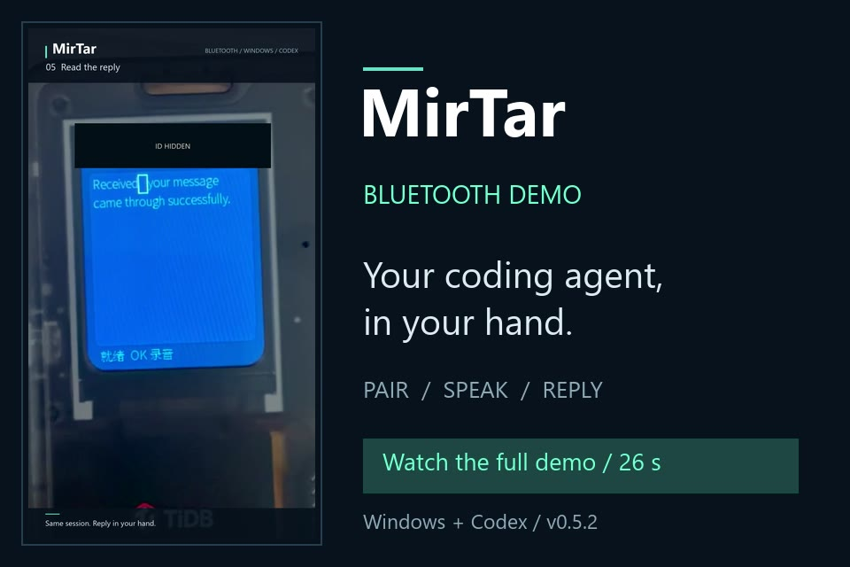

# Bluetooth demo / 蓝牙演示

26 October 2026 · MirTar v0.5.2

- [Watch / download the full video with music](https://github.com/Charlesmpc/MirTar/releases/download/v0.5.2/MirTar-bluetooth-demo-v0.5.2.mp4)
- [Without background music](https://github.com/Charlesmpc/MirTar/releases/download/v0.5.2/MirTar-bluetooth-demo-v0.5.2-no-music.mp4)
- [Video checksums](https://github.com/Charlesmpc/MirTar/releases/download/v0.5.2/MirTar-demo-SHA256SUMS.txt)

Real owner-provided badge footage shows selecting a saved computer, choosing Bluetooth, displaying the pairing prompt, connecting to Codex, pressing OK to record and send, and receiving a reply. Windows-side code entry happens off camera. This short demonstration does not establish continuous ten-minute badge recording or every recovery scenario.

The 60.1-second source was edited to approximately 26.1 seconds, with upright orientation baked into the pixels, two-pass stabilization, gentle framing changes, and an original locally synthesized 112 BPM electronic beat. Speech remains at normal speed; the music ducks under it. Pairing wait is marked **×5**, processing wait **×8**. The README animation is a further **×4 preview**, not a latency measurement.

Personal host labels, the personal build label and the pairing code are covered with opaque masks following the LCD on every frame. Earlier conversation content is removed from the edit. Original recordings, unredacted frames, local editing scripts and personal firmware are not published. Editing and audio processing were local; no recording was sent to an external transcription service.

Video: 1080 × 1920, 30 fps, H.264/AAC MP4, fast-start playback, source metadata removed. The music and no-music editions contain the same edited video. Existing v0.5.2 firmware and source release assets are unchanged.

这段实机录像展示了选择电脑、蓝牙配对、连接 Codex、按 OK 录音、再次按 OK 发送及卡片回显回复；Windows 侧输入配对码没有入镜。配对等待与处理等待分别标注 5 倍、8 倍加速，语音部分保持原速，背景音乐在人声时自动减弱。首页动图另以 4 倍速播放，仅供预览，不代表实际响应速度。

公开版本遮挡个人主机名、个人版标识与配对码，并删除旧聊天内容。原始素材和个人固件保留在本地。该短片可以说明本次蓝牙连接和短语音回显流程；真实卡片连续录音十分钟、电量和长期稳定性仍需单独验证。
